<p align="center">
  
</p>

<p align="center">
  <a href="LICENSE"></a>
  
  
  
</p>

<h1 align="center">⚡ Paste a link. Get clips that are ready to blow up. ⚡</h1>

<p align="center"><b>SniperClips</b> turns any long video — a stream, a podcast, a breakdown — into <b>4–5 vertical clips</b> built for TikTok, Reels and Shorts.<br>
It finds the hook, cuts the complete thought, burns word-by-word captions, reframes to 9:16 — and <b>warns you before copyright does</b>.</p>

<p align="center">
  <i>🎬 Real output: this tool has already cut clips from a Hindi GTA 6 video — hook title, captions, 1080×1920.<br>
  Run it yourself and open <code>clips/index.html</code> to watch yours.</i>
</p>

---

## 🔥 Why SniperClips exists

The big clipping tools charge **$15–29/month**, burn your money in "credits" for clips you throw away, and hide their picks behind a magic "virality score" that independent testing found **uncalibrated** — in one 30-day test, a tool's best-performing clip scored **64** and its weakest **87**.

Worse: **not one of them checks copyright.** Their terms quietly put 100% of the risk on you.

And for a billion people? **The biggest tool in the world has no Hindi at all.**

SniperClips is the answer: **free, open-source, runs on your own machine, Hinglish-first, and honest about risk.**

## ⚔️ SniperClips vs the paid giants

| | **SniperClips** | Opus Clip | Vizard | Klap |
|---|---|---|---|---|
| Price | **Free, forever** | $15–29/mo | $29/mo | $29/mo |
| Credits / minute traps | **None** | Yes | Yes | Per-clip |
| Hindi support | **Yes — Hinglish-first** | ❌ None | Listed | Listed |
| Roman Hinglish captions | **Roadmap priority** | ❌ | ❌ | ❌ |
| Copyright pre-check | **✅ GREEN / YELLOW / RED** | ❌ | ❌ | ❌ |
| "Why was this clip picked?" | **Explained, in writing** | Magic score | Magic score | Magic score |
| Runs on your machine | **✅** | ❌ Cloud only | ❌ | ❌ |
| Open source | **✅ Apache 2.0** | ❌ | ❌ | ❌ |

## ✨ What it does

- 🎯 **Hook-first structure** — the single most electric sentence in the moment is moved to the front and burned in as a big title for the first 3 seconds. No clip starts mid-thought, ever: cuts snap to complete sentences.
- 🗣️ **Hinglish ears** — hype detection understands `bhai`, `khatarnak`, `tabahi`, `arre dekh` — not just English. Gaming streams are the home turf.
- 🔊 **Three signals, not one** — transcript hype + audio energy peaks + speech pace. A shout, a clutch, a gasp — all of it counts.
- 🛡️ **Copyright shield (a world first)** — every clip gets a risk flag: **GREEN** speech throughout, **YELLOW** some unexplained loud non-speech (likely music), **RED** mostly music. A plain-language report tells you where claims usually come from — *before* you post. (Honest note: nobody can guarantee safety — YouTube's Content ID database is private. We warn; we never lie.)
- 📝 **Transparent picks** — every clip ships with a written report: the exact hype words found, the energy peak, the pace, the risk flag. No magic numbers.
- 📱 **Phone-perfect output** — 1080×1920, blurred-pad reframe (the speaker never gets cropped out), captions in the safe zone.
- 🖼️ **One gallery page** — all your clips on a single dark page, ready to watch and download on your phone.

## 🚀 Quick start

**You need:** Python 3.10+ and [ffmpeg](https://ffmpeg.org/download.html) on your machine.

```bash
git clone https://github.com/oumar9018-cmd/SniperClips.git
cd SniperClips
python3 -m venv venv
venv/bin/pip install -r requirements.txt
```

**Make clips:**

```bash
venv/bin/python sniperclips.py "https://youtube.com/watch?v=..." --clips 5
```

Your clips, reports and gallery land in `clips/` — open `clips/index.html` and watch them.

## 🧠 How it works

```
link ──► download (yt-dlp)
     ──► energy map (audio peaks, per second)
     ──► transcription (Whisper, word timestamps)
     ──► moment scoring (hype words × energy × pace × questions)
     ──► hook shift + sentence-snapped cuts
     ──► copyright pre-check (speech density vs energy)
     ──► 9:16 reframe + captions + hook title
     ──► clips + REPORT.md + COPYRIGHT-REPORT.md + gallery
```

## 🗺️ Roadmap

- **v3** — face-cam aware crop · Roman-Hinglish caption transliteration · outro/CTA penalty · auto titles + hashtags
- **v4** — a simple web page: paste a link in the browser, download your clips

## ⚠️ Honest limitations

- Transcription quality depends on the Whisper model size you can run — bigger model, better Hinglish, slower machine time.
- The copyright shield reads risk signals in the audio; it is a warning system, not a guarantee and not legal advice. Only clip content you have the rights or permission to use.
- Cutting/rendering is CPU work — roughly a minute per clip on a modest machine.

## 📜 License

Apache 2.0 — © 2026 Farzan Iqbal. Free to use, free to build on. If SniperClips makes your channel grow, a star ⭐ is all the payment we ask.

<p align="center"><b>Grow clips. Not bills.</b></p>
